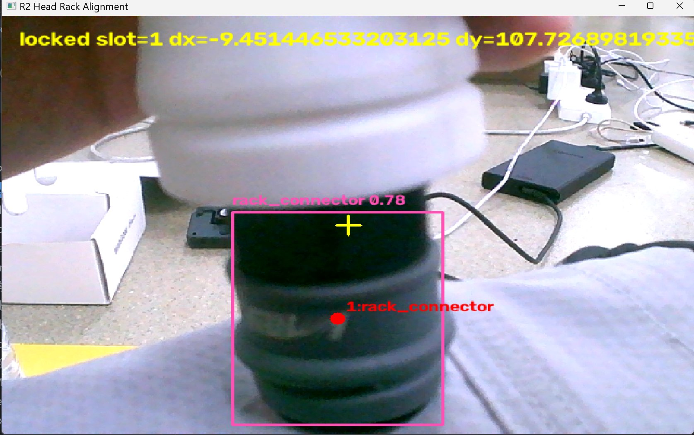
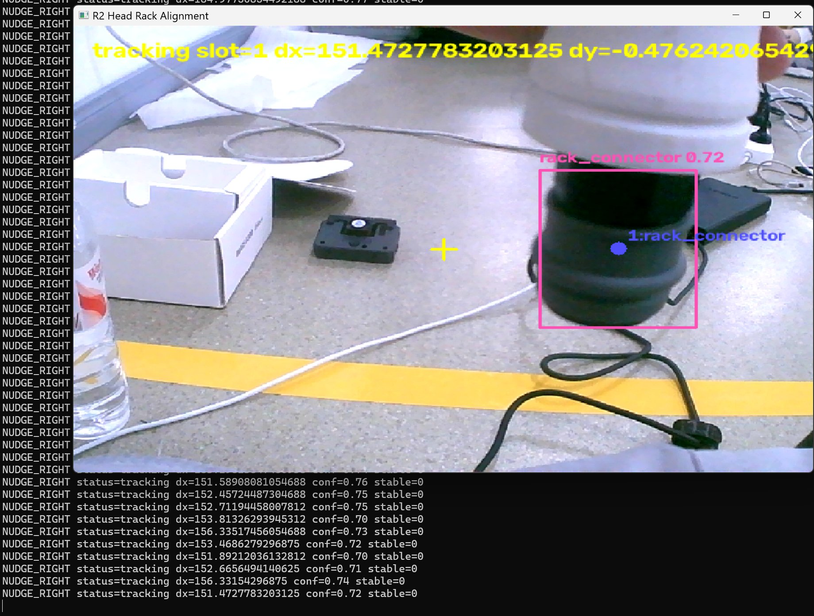
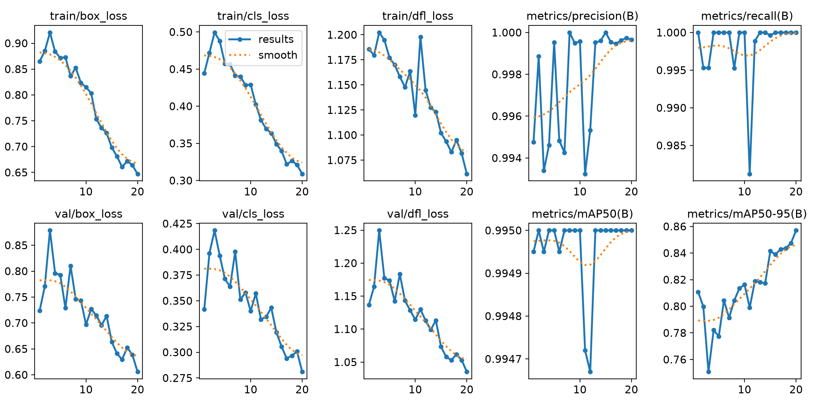

# Robocon 2026 视觉模块：武器架快接头识别与夹爪对位

给 R2 机器人的夹爪加一双眼睛——检测武器架上的快接头，输出目标相对夹爪的左右偏差，转成控制码交给底盘做微调，实现 **识别 → 定位 → 动作** 闭环。

2026 全国大学生机器人大赛 ROBOCON「武林探秘」技能挑战赛参赛作品，本人独立负责该视觉模块。



*实机运行：检出 `rack_connector`（置信度 0.78），黄色十字是标定的夹爪抓取基准点，红点是目标中心，两者偏差即 `dx_px` / `dy_px`。此时偏差已进入阈值，状态转为 `locked`。*

---

## 背景

R2 需要在武器架前把夹爪对准快接头完成取件。人工遥控对位依赖操作手经验，误差大、耗时长，姿态稍有偏差就会夹空。这个模块要解决的问题是：**让底盘自己知道还差多少、往哪边修**。

做法上刻意把视觉和控制的耦合面收窄——视觉模块不输出图像坐标，只输出一个整数 `control_code`，底盘状态机直接读取执行，两边可以独立迭代。

## 系统流程

```
USB 摄像头取帧
   ↓
YOLOv8 检测 rack_connector，得到目标框
   ↓
取目标框中心，与标定的「夹爪抓取基准点」求差
   ↓
得到 dx_px / dy_px（像素偏差）
   ↓
阈值判定 + 稳定帧计数（滞回，避免抖动来回修正）
   ↓
输出 control_code (-2 ~ 2)
   ↓
底盘状态机 → 左右微调 → 重新取帧
```

## 实机运行：两种状态

对准之前，程序停在 `tracking`，把偏差换算成修正方向交给底盘：



*`dx = 151 px`，超出阈值，输出 `NUDGE_RIGHT`，底盘向右小步修正。左侧是逐帧调试日志，底部是发给状态机的 JSON 流。*

偏差收进阈值后转 `locked`（见首图，`dx = -9.4 px`），此时才允许进入机械二次确认。两张图是同一条链路的两个阶段，也是这个模块真正在解决的问题——**不是"能不能检测到"，而是"检测到之后怎样稳定地告诉底盘该怎么办"**。

## 关键设计

**1. 输出控制码而不是坐标**

`control_code` 只有五个取值，语义在文档里写死，底盘同学不需要理解视觉内部逻辑：

| 值 | 含义 |
|---|---|
| `-2` | 无可靠目标，禁止抓取，停止微调或重新搜索 |
| `-1` | 向左小步修正 |
| `0` | 已在阈值内，保持或等待 |
| `1` | 向右小步修正 |
| `2` | 视觉已锁定，停止微调，进入机械二次确认 |

**2. 锁定不等于可以夹**

代码里明确区分「视觉对准」和「可以夹取」。`control_code == 2` 只代表左右方向稳定，真正闭合夹爪前，状态机还需要确认底盘停稳、高度到位、前后距离到位，并在停稳后继续确认 3~5 帧。这条约束是现场夹空几次之后加上的。

**3. 标定基准点，而不是假设画面中心**

摄像头安装位置和夹爪不同轴，画面中心不等于抓取点。用 `tools/pick_grab_center.py` 采集标定图，人工点出抓取基准点，写进 `configs/r2_gripper.yaml`。换摄像头或调整支架后必须重标。

**4. 丢目标时降级而不是硬猜**

快接头容易被掌、拳、矛遮挡，检测丢失时走 `fallback` 分支，宁可输出 `-2` 停下来，也不输出错误的修正方向。

## 训练与指标

- 模型：YOLOv8（权重 6 MB，便于边缘端部署），imgsz 640，batch 8，20 epoch
- 数据集：现场采集 + `tools/auto_label_yolo.py` 自动预标注 + 人工修正，`tools/build_yolo_dataset.py` 构建
- 离线验证：**mAP50 = 0.995，mAP50-95 = 0.857，Precision 0.999，Recall 1.000**



> 需要说明：验证集与训练集同源采集（同一批视频抽帧），指标偏乐观，实际抓取成功率以现场实机测试为准。这个模块真正的难点不在检测精度，而在实机光照、遮挡和底盘停位抖动下的稳定性。

## 目录结构

```
head_rack_align/     核心逻辑
  camera.py          取流
  detector.py        YOLO 封装
  geometry.py        像素→偏差的几何解算
  targeting.py       目标选择
  stabilizer.py      稳定帧计数与滞回
  fallback.py        遮挡/丢失时的降级策略
  app.py             主循环，输出 JSON
configs/             桌面测试 / 近距测试 / 实机三套参数
models/              rack_connector v3 / v5 权重
tools/               采集、自动标注、数据集构建、相机标定、基准点标定、部署脚本
docs/                中文文档：部署、状态机接口、安全须知、现场测试清单
```

## 输出格式

每帧输出一行 JSON，供状态机读取：

```json
{"status":"tracking","target_slot":1,"target_type":"rack_connector",
 "dx_px":-42.1,"dy_px":-38.5,"confidence":0.86,"stable_frames":0,
 "target_valid":1,"control_code":-1,"x_direction":-1,"action_hint":"nudge_left"}
```

## 快速开始

```bash
pip install -r requirements.txt
python tools/run_image.py --source 0            # 单帧测试
.\tools\run_r2_gripper_v5.ps1                   # Windows 实时运行
bash tools/run_r2_gripper_v5_jetson.sh          # Jetson 运行
python tools/state_machine_reader_demo.py --camera 0 --show   # 模拟状态机读取
```

摄像头更换或支架调整后重新标定：

```bash
python tools/pick_grab_center.py --camera 0
```

把输出的 `grab_center_x` / `grab_center_y` 写回 `configs/r2_gripper.yaml`。

## 关于本仓库

- 本仓库只包含视觉模块单体，整机代码、底盘控制、机械结构由队伍其他成员维护，遵循队伍保密要求未公开。
- 数据集不随仓库发布；`models/` 中的权重仅针对本赛题目标训练，不具备通用性。
- 更多细节见 `docs/`，其中 `r2_gripper_vision_cn.md` 是完整设计说明，`r2_jetson_deploy_cn.md` 是部署流程。

## 后续可改进

- 目前只闭环左右方向，前后距离和高度依赖机械限位与预定位；补单目测距或结构光后可以做成三维闭环。
- 快接头被遮挡时仍依赖 fallback 停下等待，可以改成主动搜索（小幅扫视）后重新定位。
- 稳定判定用的是固定帧数，按底盘实际停位抖动改成自适应阈值会更稳。
